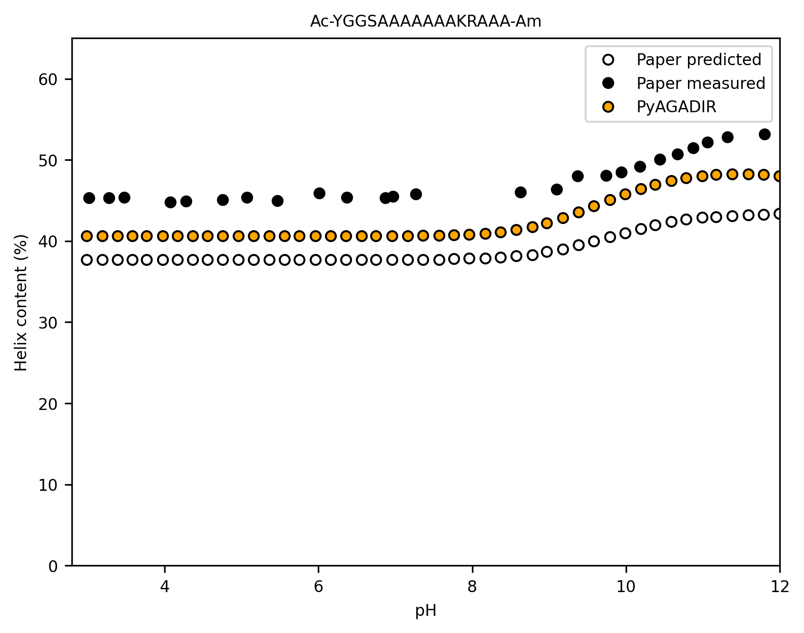
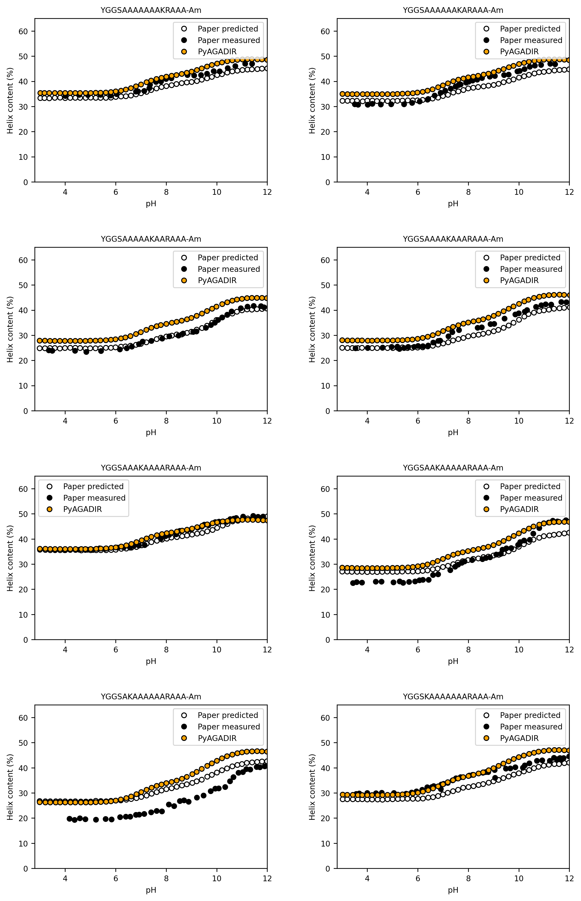
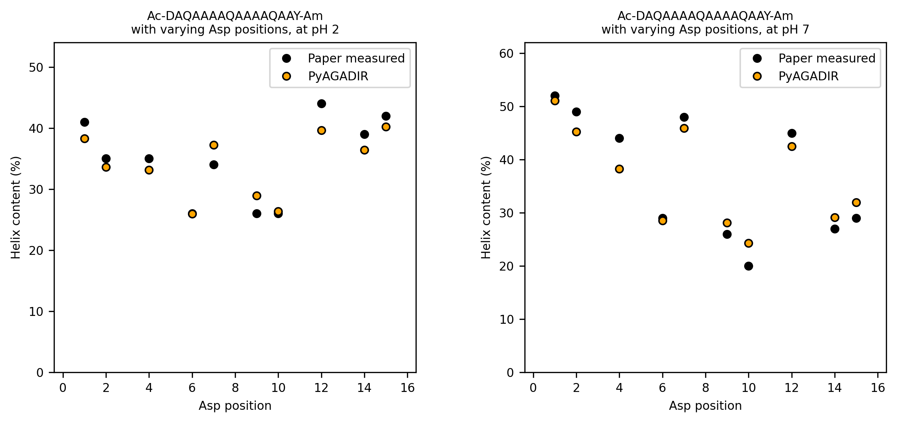
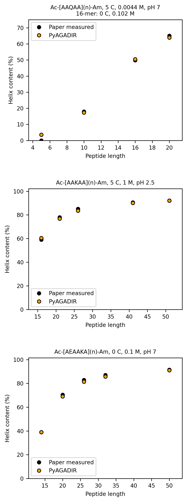
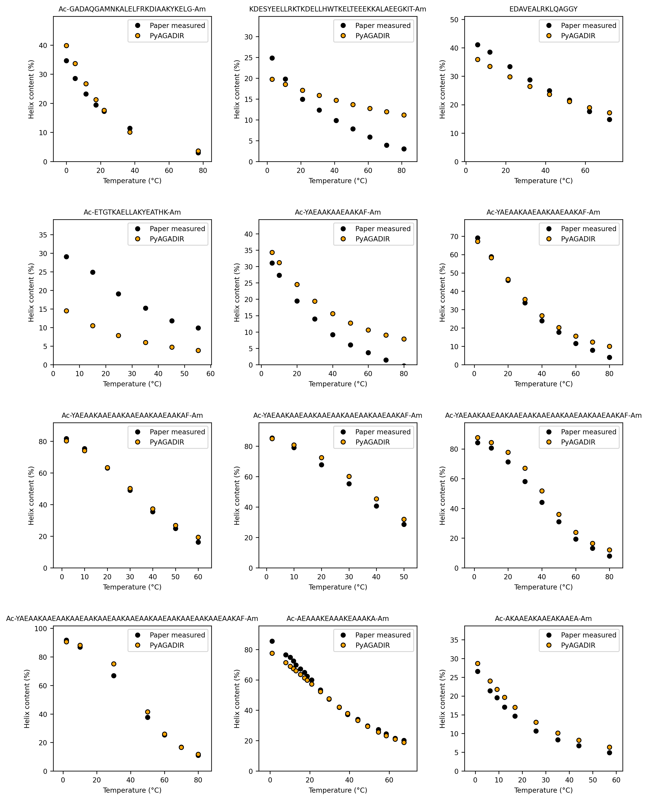

# α-helix probability model (pyAGADIR)

## Model Description

An open-source, Python implementation of Munoz & Serrano's AGADIR model of α-helix formation. This model uses statistical mechanics and energy parameters trained on a database of over 400 peptides to predict the α-helical tendency (probability) per residue for a given peptide (see references).

The energy parameters used in this model were extracted from the supplementary material of Lacroix, E., Viguera, A. R., & Serrano, L. (1998). Elucidating the folding problem of α-helices: local motifs, long-range electrostatics, ionic-strength dependence and prediction of NMR parameters. Journal of molecular biology, 284(1), 173-191. https://doi.org/10.1006/jmbi.1998.2145 Where a value departs from the published tables, `pyagadir/params/README.md` gives the change and the measurements behind it.

The paper uses the terminology of Richardson & Richardson (1988) where STC (S, strand; T, turn; and C, coil) indicates a non-helical conformation and He is a helical residue. Positions are 0-based (Python) indices into the sequence, and a helical segment is specified by the index i of its N-cap and its length j, which counts both caps. The first and last residues of the specified helical segments act as "capping" residues (Ncap and Ccap). 

In the following example, the helical segment is specified by i=2 and j=14.
```text
Sequence:  I    L    K     S    L    E    E    F    L    K    V    T    L    R    S    T    R    Q  
Name:      N''  N'   Ncap  N1   N2   N3   N4   N5.............C5   C4   C3   C2   C1   Ccap C'   C''  
Structure: STC  STC  STC---He---He---He---He---He---He---He---He---He---He---He---He---STC  STC  STC
Index:     0    1    2     3    4    5    6    7    8    9    10   11   12   13   14   15   16   17
```

The N- and C-terminal residues can optionally be modified with acetylation, succinylation, or amidation. This is done to remove the influence of the terminal charges on the helical propensity. The model accounts for these modifications and treats them as indexable positions in the sequence. 

In the following example, the sequence is acetylated at the N-terminal and amidated at the C-terminal, with the helical segment specified by i=1 and j=6.
```text
Sequence:  Ac   K     S    L    E    E    F    L    K    V    T    L    R    S    T    R    Am 
Name:      N'   Ncap  N1   N2   C2   C1   Ccap C'   C''  
Structure: STC  STC---He---He---He---He---STC  STC  STC  STC  STC  STC  STC  STC  STC  STC  STC
Index:     0    1     2    3    4    5    6    7    8    9    10   11   12   13   14   15   16
```

For predicting the helical propensity of a sequence, the model uses the partition function, which is the sum of the statistical weights of all possible helix conformations of the sequence (the coil state has weight 1); the model iterates over all possible i, j pairs and calculates the weight of each. The helical propensity of a residue is then the summed weight of the conformations in which it is helical, divided by the partition function.


## Installation

pyagadir needs Python 3.10 or later, and its only dependencies are NumPy and pandas. Install it from GitHub with pip:

```bash
pip install git+https://github.com/mengqvist/AGADIR.git
```

or add it to a [uv](https://docs.astral.sh/uv/) project:

```bash
uv add git+https://github.com/mengqvist/AGADIR.git
```

### Development

Clone the repository and let uv create the environment. `uv sync` installs pyagadir in editable mode, together with pytest and matplotlib (for the validation plots):

```bash
git clone https://github.com/mengqvist/AGADIR.git
cd AGADIR
uv sync
uv run pytest
```

Without uv, `pip install -e . pytest matplotlib` sets up the same thing in any virtual environment.

## Usage

The most simple way to use this package is to import and invoke the `AGADIR` model directly:
```python
from pyagadir.models import AGADIR

# Initialize model with custom parameters
model = AGADIR(
    method='1s',   # Method for partition function: 'r' (residue) or '1s' (one-sequence)
    T=4.0,         # Temperature in Celsius
    M=0.15,        # Ionic strength in mol/L
    pH=7.0         # pH of solution
)

# Predict helical propensity
result = model.predict('ILKSLEEFLKVTLRSTRQT')
```

The result object provides several methods to access the predictions:
- `get_sequence()`: Returns the input peptide sequence
- `get_percent_helix()`: Returns the mean helical propensity (float)
- `get_helical_propensity()`: Returns the helix percentage at each position (numpy array; includes the cap positions when `ncap`/`ccap` are given)

### Terminal Capping

When predicting helix propensity, the charged termini can significantly affect the results. In real proteins, helices are typically part of a larger sequence and don't experience these terminal charges. The package supports three types of terminal modifications to simulate this:

- N-terminal modifications (ncap):
  - `'Ac'`: Acetylation - can act as a helix capping residue and neutralizes the positive N-terminal backbone charge.
  - `'Sc'`: Succinylation - can act as a helix capping residue, neutralizes the positive N-terminal backbone charge, BUT is treated as negatively charged.
- C-terminal modification (ccap):
  - `'Am'`: Amidation - can act as a helix capping residue and neutralizes the negative C-terminal backbone charge.

These modifications are particularly important when analyzing helices extracted from larger proteins. For example, if you're predicting the helical propensity of a segment taken from a crystal structure, you should consider adding these caps to better simulate the actual environment where the helix exists within the protein:

```python
# Analyzing a helix segment from a protein structure
segment = "ILKSLEEFLKVTLRSTRQT"
model = AGADIR(method='1s', T=4.0, pH=7.0)
result = model.predict(segment, 
                       ncap='Ac', 
                       ccap='Am'
                       )  # Add caps to simulate internal protein environment
```

### Energy Calculations

For detailed analysis, you can use the `EnergyCalculator` class directly to examine specific energy contributions. This class is used internally by the `AGADIR` model to calculate the partition function, but can also be used to calculate the energy contributions for a given sequence. It is important to note that the `EnergyCalculator` class only calculates the energy contributions for a single helix segment (a single i, j pair for a given sequence), and does not calculate the partition function.

```python
from pyagadir.energies import EnergyCalculator

seq = "ILKSLEEFLKVTLRSTRQT"

# Initialize calculator for one helical segment. i is the segment's N-cap index and j its
# length including both caps, counted in the sequence with any terminal modifications added
# (here Ac at index 0 and Am at the end, so i=0, j=len(seq)+2 spans the whole peptide).
calc = EnergyCalculator(
    seq=seq,
    i=0,
    j=len(seq) + 2,
    pH=7.0,  # pH of solution
    T=4.0,  # Temperature in Celsius
    ionic_strength=0.15,  # Ionic strength in mol/L
    ncap='Ac',  # N-terminal acetylation
    ccap='Am'  # C-terminal amidation
)

# Basic helix energies
intrinsic_energy = calc.get_dG_Int()  # Returns: np.ndarray
hbond_energy = calc.get_dG_Hbond()    # Returns: float

# Capping energies
ncap_energy = calc.get_dG_Ncap()      # Returns: np.ndarray
ccap_energy = calc.get_dG_Ccap()      # Returns: np.ndarray

# Special motif energies
staple_energy = calc.get_dG_staple()    # Returns: float
schellman_energy = calc.get_dG_schellman()  # Returns: float

# Side chain interactions
i3_interactions = calc.get_dG_i3()    # Returns: np.ndarray
i4_interactions = calc.get_dG_i4()    # Returns: np.ndarray

# Electrostatic and dipole interactions
sidechain_pairs = calc.get_dG_sidechain_sidechain_electrost()  # Returns: np.ndarray (pair matrix)
term_n, term_c = calc.get_dG_terminals_sidechain_electrost()  # Returns: tuple[np.ndarray, np.ndarray]
n_term_macro, c_term_macro = calc.get_dG_terminals_macrodipole()  # Returns: tuple[np.ndarray, np.ndarray]
dipole_n, dipole_c = calc.get_dG_sidechain_macrodipole()  # Returns: tuple[np.ndarray, np.ndarray]
```

Each energy term represents a different contribution to helix stability:
- Intrinsic energies: Base propensities for each residue
- H-bond energy: Main chain-main chain hydrogen bonds
- Capping energies: N- and C-terminal capping effects
- Staple motif: Hydrophobic interactions between N' and N4 residues
- Schellman motif: Special C-terminal capping interaction with glycine
- i,i+3 and i,i+4 interactions: Side chain interactions
- Electrostatic: Charged side chain pairs, and terminal charges with charged side chains
- Macrodipole: Interactions between charged residues and the helix dipole

### Protein Structures: Helices, Strands and Loops

`pyagadir.pdb_elements` splits one chain of a PDB file into helix, sheet, loop/turn and other elements (DSSP H; E; T, S and coil; G, I and B) and scores each one. Helices are scored with AGADIR as isolated peptides with two flanking residues on each side (N' and N-cap, C-cap and C', which the capping motifs need) and Ac/Am ends. Strands and loops get the empirical scores of `pyagadir.element_scores`, transferred from studies of designed mini-proteins (Rocklin et al. 2017; Kim et al. 2022): ABEGO sequence-backbone compatibility, an exposed-strand amino-acid score (measured effects from Tsuboyama et al. 2023, kcal/mol), core participation of each helix and strand, the contacts and connectivity of the hydrophobic core, buried and exposed nonpolar surface area (united-atom ProtOr radii; the buried area of hydrophobic residues was the main stability determinant in both studies), and buried polar atoms without a hydrogen-bond partner. No external programs are needed; the secondary structure is assigned by a built-in DSSP implementation.

```bash
python -m pyagadir.pdb_elements protein.pdb --chain A --T 25 --pH 7 --M 0.15 --json scores.json
```

```python
from pyagadir.pdb_elements import score_structure

report = score_structure("protein.pdb")
for element in report["elements"]:
    print(element.kind, element.first_residue, element.last_residue, element.scores)
print(report["summary"])
```

The strand and loop scores are features in the units of their source (log-odds, kcal/mol, square angstrom), not folding free energies. The surface areas track Rosetta's closely (r = 0.86-0.98 on the published designs, Rosetta's about 20% larger because it counts explicit hydrogens); the buried-unsatisfied count is a geometric approximation that agrees only loosely with Rosetta's filter.


## Validation

The implementation has been validated against the original AGADIR paper results. The validation datasets are in `data/`, so run the validation from a clone of the repository set up as described under Development:

```bash
uv run python -m pyagadir.validation
```

This will generate comparison plots in the `figures/` directory.

To get numerical scores instead of plots, run the scoring script:

```bash
uv run python -m pyagadir.scoring --metric rmse
```

Available metrics are `mse`, `rmse`, `mae`, and `pearsonr`. The script prints one score per subplot, keyed by figure name. The individual `score_*` functions and `score_all()` in `pyagadir/scoring.py` accept a `metric=` argument and can be called directly from an optimiser.

Below is a validation plot for Figure 3b with reference data extracted from the original paper (Lacroix et al., 1998, using WebPlotDigitizer), showing the pH dependence of helix content:



Below is a validation plot for Figure 4 with reference data extracted from the original paper (Lacroix et al., 1998, using WebPlotDigitizer), showing the pH dependence of helix content:



Below is a validation plot for Figure 1A and 1B from Huyghues-Despointes et al. (1993), showing peptides with Asp at different positions, at two pH values:



Below is a validation plot for Figure 4A-C from Munoz & Serrano (1997), showing repeats of the peptides AAQAA, AAKAA and AEAAKA:



Below is a validation plot for Figure 3 from Munoz & Serrano (1995), with panel 3D replaced by the designed peptides of Scholtz et al. (1991) and Marqusee & Baldwin (1987), showing temperature dependence of peptide helicity:




## Citations

Muñoz, V., & Serrano, L. (1994). Elucidating the folding problem of helical peptides using empirical parameters. Nature structural biology, 1(6), 399-409. https://doi.org/10.1038/nsb0694-399

Munoz, V., & Serrano, L. (1995). Elucidating the folding problem of helical peptides using empirical parameters. II†. Helix macrodipole effects and rational modification of the helical content of natural peptides. Journal of molecular biology, 245(3), 275-296. https://doi.org/10.1006/jmbi.1994.0023

Muñoz, V., & Serrano, L. (1995). Elucidating the Folding Problem of Helical Peptides using Empirical Parameters. III. Temperature and pH Dependence. Journal of molecular biology, 245(3), 297-308. https://doi.org/10.1006/jmbi.1994.0024

Lacroix, E., Viguera, A. R., & Serrano, L. (1998). Elucidating the folding problem of α-helices: local motifs, long-range electrostatics, ionic-strength dependence and prediction of NMR parameters. Journal of molecular biology, 284(1), 173-191. https://doi.org/10.1006/jmbi.1998.2145

Munoz, V., & Serrano, L. (1997). Development of the multiple sequence approximation within the AGADIR model of α‐helix formation: Comparison with Zimm‐Bragg and Lifson‐Roig formalisms. Biopolymers: Original Research on Biomolecules, 41(5), 495-509. [https://doi.org/10.1002/(SICI)1097-0282(19970415)41:5<495::AID-BIP2>3.0.CO;2-H](https://doi.org/10.1002/(SICI)1097-0282(19970415)41:5<495::AID-BIP2>3.0.CO;2-H)

